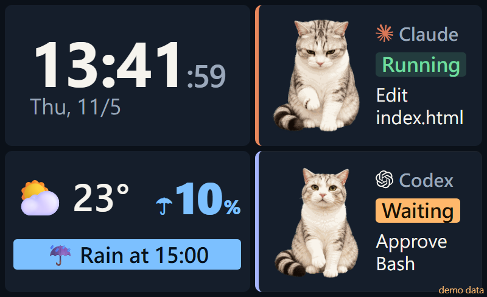

# agent-status-screen

**English** | [繁體中文](README.zh-TW.md)



A small always-on status screen for **Claude Code** and **Codex**. At a glance you can see whether each agent is
running, waiting for your approval, done or offline, plus the tool and file it is working on. You don't have to keep
switching back to the terminal to find out whether it needs you.

The page has four cards: clock and date, weather with the rain chance for the next 3 hours, Claude, and Codex.
Each agent card has a cat, Beelu, whose pose follows the state: looking up while thinking, tilting the head while
reading, typing on a laptop while editing, waving when the agent needs you, jumping when done and sleeping when
offline.

It was made for a tiny wireless display (about 9 x 5.5 cm) connected with Win+K, so the text is large and only
glanceable information is shown. Any second monitor works, and so does a normal browser window.

## How it works

```
Claude Code / Codex hooks ──UDP 127.0.0.1:57999──▶ server.py ──HTTP 127.0.0.1:8765──▶ browser kiosk (second screen)
                                                      └── Open-Meteo weather (every 30 min)
```

- To Windows, a wireless display is just another monitor. Connect it with Win+K and choose **Extend**.
- Every 3 seconds `screen.ps1` looks for a non-primary monitor no wider than 1366 px. When one appears, it opens the
  page there in Chrome / Edge `--kiosk` mode (full screen); when the monitor goes away, it closes the window.
- The server and the UDP receiver listen on `127.0.0.1` only. Nothing is opened to the network.
- **The hooks send only the state and "tool name + file name / first command word"** (for example `Edit main.py`,
  `Bash git`). They never send your prompts, full commands, file contents or tool output. When a command name is not a
  plain file-name-like word, only the tool name is sent. If the server is not running, the packets are simply dropped,
  so Claude Code and Codex are never slowed down.

## Requirements

- Windows 10 / 11. Only `screen.ps1` (the automatic kiosk) is Windows-only; `server.py` runs anywhere.
- Python 3.9 or later. No packages needed, except Pillow if you use your own full Codex pet spritesheet.
- Chrome or Edge.

> On Windows, the `python` command may be the Microsoft Store placeholder. Use `py -3` (the launcher that comes with
> the installer from python.org).

## Setup

1. Download this repository, for example to `C:\tools\agent-status-screen`. **The path must not contain spaces**
   (the Codex hook command needs that).
2. Optional: copy `config.example.json` to `config.json` and edit it (see [Configuration](#configuration)).
   Without it you get the defaults: no weather card, screen always on, Traditional Chinese text.
   For English, set `"lang": "en"`.
3. Set up the hooks (below). In the examples, replace `C:\path\to\agent-status-screen` with your path.
4. Double-click `screen.cmd`. When you connect the small screen with Win+K, the page opens there automatically.
   - Start at sign-in: press Win+R, type `shell:startup`, and put a shortcut to `screen.cmd` in that folder.
   - Stop everything: `screen.cmd -Stop`
   - No small screen: once the server is running, open <http://127.0.0.1:8765/> in any browser.
   - Use a normal external monitor instead: by default only monitors up to 1366 px wide are used, so your work
     monitor is left alone. Run `screen.cmd -Stop`, then `screen.cmd -MaxWidth 1920` to allow a 1920 px wide monitor
     (the whole monitor becomes the status page). Add the same argument to the startup shortcut.

### Claude Code hooks

Merge the `hooks` section of [hooks/claude-settings.example.json](hooks/claude-settings.example.json) into
`%USERPROFILE%\.claude\settings.json`. If you already have `hooks`, add these entries to each event. All of them are
`async`, so Claude Code never waits for them.

| Event | Sends |
|---|---|
| `UserPromptSubmit` | `RUN\|thinking...` |
| `PreToolUse` | `RUN\|<tool> <file / command>`; `AskUserQuestion` → `WAIT\|question` |
| `PostToolUse` | `RUN` (back to running after you approve) |
| `Notification` (permission prompt, dialog) | `WAIT\|approve <tool>` |
| `Stop` | `DONE` |
| `SessionEnd` | `OFF\|` |

Test: set `$env:AGENT_STATUS_DRYRUN=1` and run the script; it prints the packet instead of sending it.

### Codex hooks

Save [hooks/codex-hooks.example.json](hooks/codex-hooks.example.json) as `%USERPROFILE%\.codex\hooks.json` (or merge
it into your existing file), then review and trust the hooks with `/hooks` in Codex. Untrusted hooks are skipped.
The path in the command must not contain spaces, and do not put quotes around it.

Test (PowerShell): `'{"hook_event_name":"Stop"}' | py -3 hooks\codex-status.py --dry-run`

Both hooks send to `127.0.0.1:57999`. To send to another computer, set the environment variables
`AGENT_STATUS_HOST` / `AGENT_STATUS_PORT`. On that computer, set `udp.host` to `0.0.0.0` in `config.json` and allow
the port in the firewall.

## Configuration

All settings in `config.json` are optional.

| Key | Default | Meaning |
|---|---|---|
| `lang` | `zh-TW` | Page language: `zh-TW` or `en` |
| `pet` | `pets/beelu/atlas.png` | The character image. Can point to your own **Codex pet folder** or its `spritesheet.png` (needs Pillow) |
| `weather` | none (no weather card) | `name`, `lat`, `lon`; optional `rain_alert_pct` (60), `rain_alert_mm` (0.1), `rain_ahead_hours` (2), `refresh_min` (30), `temperature_unit` (`fahrenheit`), `use_http` (`true` = plain http, for networks that break HTTPS) |
| `display_hours` | none (always on) | Show the page only in this window and keep the screen black otherwise: `days` (1 = Monday … 7 = Sunday), `start`, `end`, `off_dates`, `on_dates` (`YYYY-MM-DD`, these override `days`) |
| `agent_stale_hours` | 3 | An agent with no packet for this long is shown as offline |
| `http_port`, `udp` | 8765, `127.0.0.1:57999` | If you change `http_port`, also pass `-Port` to `screen.cmd` |

After changing the config, restart the server: `screen.cmd -Stop`, then double-click `screen.cmd`.

### Choosing the weather location

Weather comes from [Open-Meteo](https://open-meteo.com/) (free, no API key); you only need the latitude and
longitude. To look a place up by name:

```
py -3 tools\find_location.py London --lang en
py -3 tools\find_location.py London --lang en --pick 1
```

The first command lists matching places; the second writes match no. 1 into `config.json`. If you get
`CERTIFICATE_VERIFY_FAILED` (a network that intercepts HTTPS), add `--http`. You can also copy the coordinates from a
map and fill them in yourself.

**Rain alert**: if an hour within the next 2 hours has a rain probability ≥ 60% **and** forecast rain ≥ 0.1 mm, the
weather card shows "☔ Rain at 15:00". The rain amount condition is there because Open-Meteo's probability comes from
ensemble forecasts and can report 70–80% even when every model forecasts 0 mm (this happens a lot in Taiwan). Tune
`rain_alert_pct` / `rain_alert_mm` if you get too many or too few alerts.

## Using your own pet

A Codex pet spritesheet (1536 x 2288, 8 columns x 11 rows) works as is: set `"pet": "C:\\path\\to\\your-pet-folder"`
in `config.json`. At startup the server keeps only the 8 rows it uses; this needs `py -3 -m pip install pillow`.

## Previewing the layout

```
py -3 server.py --preview preview.html
```

Open `preview.html` in a browser (demo data). Add `?scene=think`, `done`, `alert` or `night` to the URL to see other
states. To see it at the size of a small screen, set the browser's device toolbar to about 800 x 488.
On the live page, `?force=off` forces the black screen and `?force=on` ignores `display_hours` (for testing).

## Known limitations

- The PC must stay on and keep projecting; locking the screen or sleeping drops a wireless display.
- Several sessions of the same agent share one card (it shows the latest event).
- Only Claude Code and Codex are supported.

## License

- Code: [MIT](LICENSE)
- Beelu image (`pets/beelu/`): [CC BY-NC 4.0](pets/beelu/LICENSE.md), not covered by the MIT license
- Claude and OpenAI icon SVG paths are from [simple-icons](https://simpleicons.org/); the logos are trademarks of
  their owners
