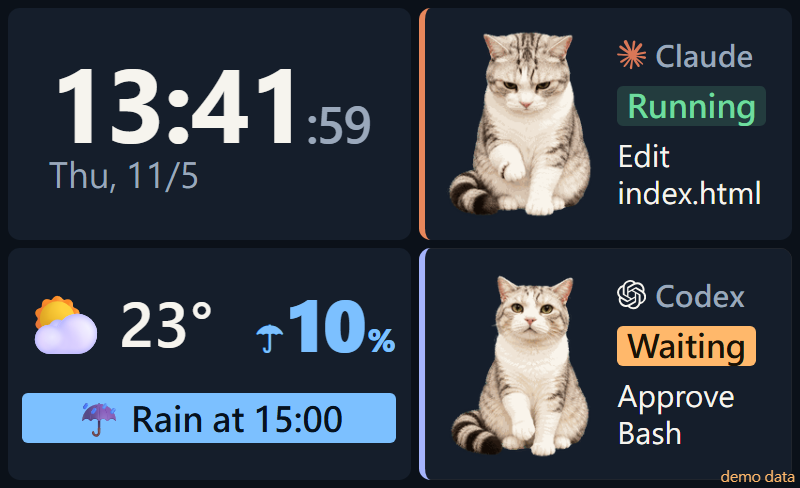

# agent-status-screen

[English](README.md) | **繁體中文**



把 **Claude Code** 和 **Codex** 現在在做什麼，顯示在桌上一個小螢幕：執行中、等你核准、完成、離線，
加上正在用的工具和檔名。做事時不用一直切回終端機，看一眼就知道要不要回去按核准。

畫面（2x2）：時鐘＋日期、天氣＋之後 3 小時降雨機率、Claude 卡、Codex 卡。每張卡都有一隻會依狀態換動作的貓「必嚕」
（思考時抬頭、讀檔時歪頭、改檔時用筆電、等你時招手、完成時跳一下、離線時睡覺）。

原本是做給 iScreen 這種 Win+K 投影的小型無線螢幕（實體約 9 x 5.5 cm），所以字都很大，只放一眼要看的東西；
任何「第二個螢幕」都能用，直接開瀏覽器看也可以。

## 原理

```
Claude Code / Codex hooks ──UDP 127.0.0.1:57999──▶ server.py ──HTTP 127.0.0.1:8765──▶ 瀏覽器 kiosk（第二個螢幕）
                                                      └── Open-Meteo 天氣（每 30 分鐘）
```

- 小螢幕對 Windows 來說就是一台顯示器。Win+K 連上、模式選「**延伸**」，它就變成第二個螢幕。
- `screen.ps1` 每 3 秒檢查有沒有「寬度 ≤ 1366 的非主螢幕」：出現就用 Chrome / Edge 的 `--kiosk` 全螢幕開在上面，消失就關掉。
- 伺服器和 UDP 都只聽 `127.0.0.1`，不對網路開 port。
- **hooks 只送狀態和「工具名稱＋檔名／指令第一個字」**（例如 `Edit main.py`、`Bash git`），
  不送你的提問、完整指令、檔案內容或工具輸出。伺服器沒開時封包直接丟掉，不會拖慢 Claude Code / Codex。

## 需求

- Windows 10 / 11（自動開 kiosk 的 `screen.ps1` 只支援 Windows；`server.py` 本身任何系統都能跑）
- Python 3.9 以上，不用裝其他套件（只有在 `pet` 指向完整的 Codex pet spritesheet 時才需要 Pillow）
- Chrome 或 Edge

> Windows 上的 `python` 指令可能是 Microsoft Store 的空殼，建議用 `py -3`（Python 官方安裝程式附的 launcher）。

## 安裝

1. 下載這個 repo，例如放在 `C:\tools\agent-status-screen`。路徑**不要有空白**（Codex hook 的指令格式需要）。
2. 複製 `config.example.json` 成 `config.json`，改成你要的設定（見下方「設定」）。不建也可以，會用預設值（沒有天氣卡、全天亮）。
3. 設定 hooks（見下方），把範例裡的 `C:\path\to\agent-status-screen` 換成你的路徑。
4. 雙擊 `screen.cmd`。之後 Win+K 連上小螢幕，畫面就會自動出現。
   - 開機自動啟動：Win+R 輸入 `shell:startup`，在裡面建一個捷徑指向 `screen.cmd`。
   - 全部關掉：`screen.cmd -Stop`
   - 沒有小螢幕、只想在瀏覽器看：伺服器啟動後打開 <http://127.0.0.1:8765/>
   - 想用一般外接螢幕：預設只會開在寬度 ≤ 1366 的非主螢幕，避免佔走你的工作螢幕；
     要開在 1920 寬的外接螢幕上，先 `screen.cmd -Stop`，再執行 `screen.cmd -MaxWidth 1920`（整台螢幕都會變成狀態畫面；開機捷徑也要加同樣的參數）

### Claude Code hooks

把 [hooks/claude-settings.example.json](hooks/claude-settings.example.json) 的 `hooks` 合併進
`%USERPROFILE%\.claude\settings.json`（已經有 `hooks` 的話，把各事件的項目加進去）。
全部是 `async`，不會讓 Claude Code 等。

| 事件 | 送出 |
|---|---|
| `UserPromptSubmit` | `RUN\|thinking...` |
| `PreToolUse` | `RUN\|<工具> <檔名／指令>`；`AskUserQuestion` → `WAIT\|question` |
| `PostToolUse` | `RUN`（核准後回到執行中） |
| `Notification`（權限、對話框） | `WAIT\|approve <工具>` |
| `Stop` | `DONE` |
| `SessionEnd` | `OFF\|` |

測試：`$env:AGENT_STATUS_DRYRUN=1` 後執行腳本，只印出要送的封包，不會真的送。

### Codex hooks

把 [hooks/codex-hooks.example.json](hooks/codex-hooks.example.json) 存成 `%USERPROFILE%\.codex\hooks.json`
（已經有的話合併進去），然後在 Codex 裡用 `/hooks` 檢視並信任它們；沒信任的 hook 會被跳過。
指令裡的路徑不能有空白，也不要在前面加引號。

測試（PowerShell）：`'{"hook_event_name":"Stop"}' | py -3 hooks\codex-status.py --dry-run`

兩支 hook 預設都送到 `127.0.0.1:57999`，要送到別台電腦時，設定環境變數 `AGENT_STATUS_HOST`／`AGENT_STATUS_PORT`
（那台的 `config.json` 也要把 `udp.host` 改成 `0.0.0.0`，並開防火牆）。

## 設定（`config.json`）

全部都可以省略。

| 欄位 | 預設 | 說明 |
|---|---|---|
| `lang` | `zh-TW` | 畫面語言：`zh-TW` 或 `en` |
| `pet` | `pets/beelu/atlas.png` | 角色圖。可以指向你自己的 **Codex pet 資料夾**或其中的 `spritesheet.png`（需要 Pillow） |
| `weather` | 無（不顯示天氣卡） | `name`、`lat`、`lon`；另有 `rain_alert_pct`（60）、`rain_alert_mm`（0.1）、`rain_ahead_hours`（2）、`refresh_min`（30）、`temperature_unit`（`fahrenheit`）、`use_http`（`true` = 改用 http，給會攔截 HTTPS 的公司網路） |
| `display_hours` | 無（一直亮） | 只在這段時間顯示，其他時間全黑：`days`（1 = 週一 … 7 = 週日）、`start`、`end`、`off_dates`、`on_dates`（`YYYY-MM-DD`，優先於星期設定） |
| `agent_stale_hours` | 3 | 超過這麼久沒收到某個 agent 的消息，就當它離線 |
| `http_port`、`udp` | 8765、`127.0.0.1:57999` | 改 `http_port` 時，`screen.cmd` 也要加 `-Port` |

改完設定要重啟伺服器：`screen.cmd -Stop` 後再雙擊 `screen.cmd`。

### 天氣地區怎麼選

天氣來自 [Open-Meteo](https://open-meteo.com/)（免費、不用 API key），只要填經緯度。用地名查：

```
py -3 tools\find_location.py 台中
py -3 tools\find_location.py 台中 --pick 1
```

第一行列出符合的地點，第二行把第 1 個寫進 `config.json`。公司網路會攔截 HTTPS（出現 `CERTIFICATE_VERIFY_FAILED`）時加 `--http`。也可以從 Google 地圖右鍵複製經緯度，自己填。

**下雨提醒**：之後 2 小時內有某小時「降雨機率 ≥ 60% **且**預測雨量 ≥ 0.1 mm」，天氣卡會顯示「☔ 15 點會下雨」。
加雨量條件是因為 Open-Meteo 的降雨機率來自集合預報，在台灣常常偏高（各模型都預測 0 mm 時也會報 70～80%）。
覺得太常或太少提醒，就調 `rain_alert_pct`／`rain_alert_mm`。

## 換成自己的 pet

Codex 的 pet spritesheet（1536 x 2288，8 欄 x 11 列）可以直接用：`config.json` 填
`"pet": "C:\\path\\to\\你的 pet 資料夾"`。伺服器啟動時會只挑用到的 8 列動作，需要 `py -3 -m pip install pillow`。

## 預覽版面

```
py -3 server.py --preview preview.html
```

用瀏覽器開 `preview.html`（示範資料），網址加 `?scene=think`／`done`／`alert`／`night` 看其他狀態。
小螢幕的比例可以用瀏覽器開發者工具設成 800 x 488 左右來看。
實際頁面網址加 `?force=off` 強制熄屏、`?force=on` 忽略 `display_hours`（測試用）。

## 已知限制

- PC 要開著並持續投影；螢幕鎖定或睡眠時投影會斷。
- 同一個 agent 同時開好幾個 session 時，共用同一張卡（顯示最後一個事件）。
- 只顯示 Claude Code 和 Codex。

## 授權

- 程式碼：[MIT](LICENSE)
- 必嚕圖片（`pets/beelu/`）：[CC BY-NC 4.0](pets/beelu/LICENSE.md)，不在 MIT 範圍內
- Claude、OpenAI 圖示的 SVG path 取自 [simple-icons](https://simpleicons.org/)，商標屬於各自的公司

